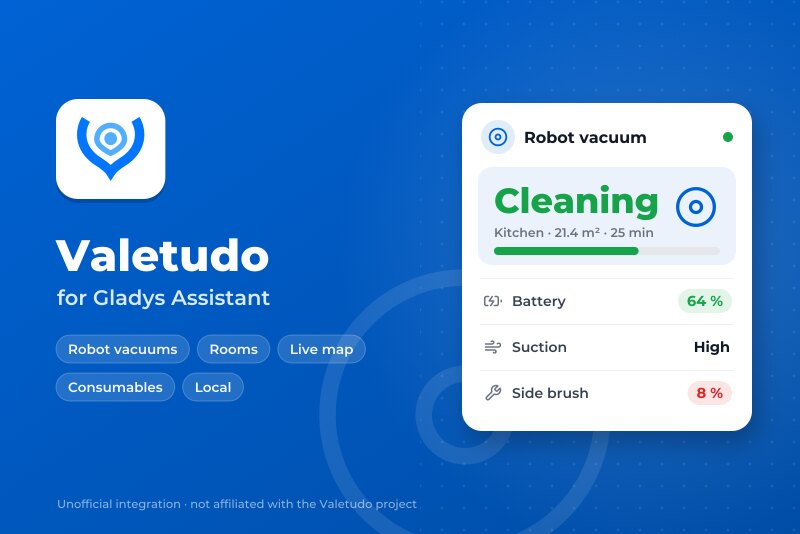
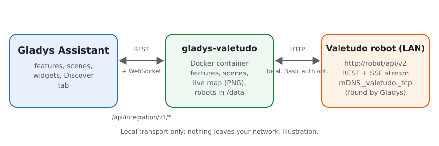
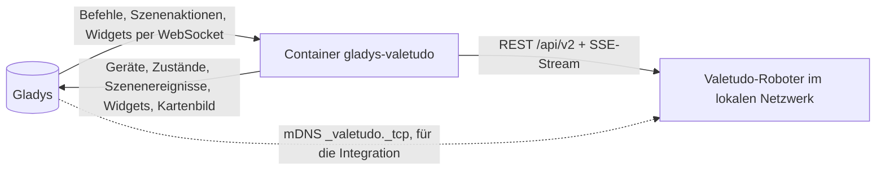
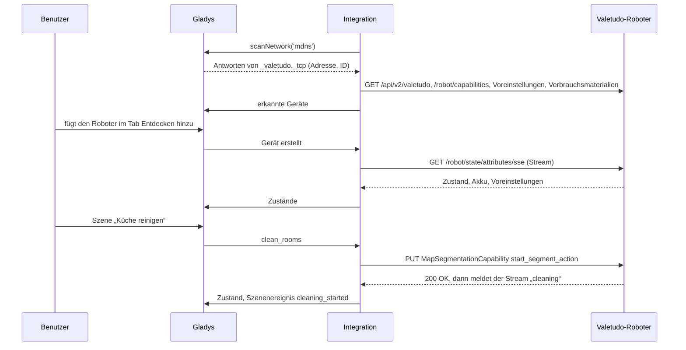
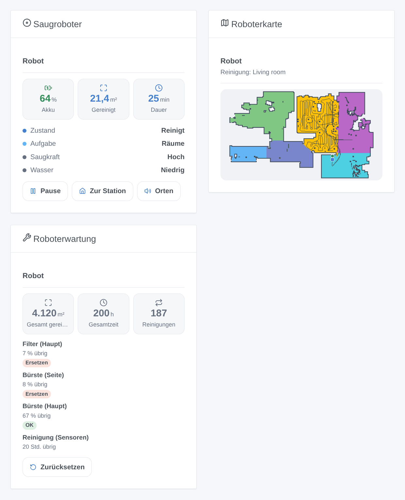

# Gladys Valetudo

[English](README.md) · [Français](README.fr.md) · **Deutsch** · [Español](README.es.md)

[](LICENSE)
[](https://github.com/William-De71/gladys-valetudo/releases)
[](https://github.com/William-De71/gladys-valetudo/actions/workflows/release.yml)
[](https://gladysassistant.com)



Externe Integration für [Gladys Assistant](https://gladysassistant.com) für Saugroboter mit **[Valetudo](https://valetudo.cloud)**, der offenen Firmware, die sie von der Cloud des Herstellers befreit. Starte, pausiere und schicke den Roboter zur Station, lass Räume aus deinen Szenen über ihren Namen reinigen, verfolge ihn live mit seiner Karte im Dashboard und erfahre, wann eine Bürste oder ein Filter ersetzt werden muss, alles im lokalen Netzwerk.

Benutzerdokumentation: [English](docs/en.md) · [Français](docs/fr.md) · [Deutsch](docs/de.md) · [Español](docs/es.md).

Nicht mit dem Valetudo-Projekt verbunden. **Noch nicht an einem echten Roboter getestet**: Die Anfragen folgen der offiziellen REST-API von Valetudo (aus dem Quellcode gelesen, Version 2026.10.0), und die Tests laufen gegen simulierte Roboter und eine echte Karte aus der Testsuite von Valetudo. Rückmeldungen sind willkommen.

## Funktionen

- **Ein Gladys-Gerät pro Roboter**, mit den nativen Saugroboter-Funktionen von Gladys: Zustand (reinigt, pausiert, kehrt zurück, lädt, in der Station, Fehler…), Betriebsart (reinigen, stoppen, kartieren), zurück zur Station, Akku und, je nach Roboter, Voreinstellungen für Saugkraft, Wasser und Modus sowie die Restlebensdauer jedes Verbrauchsmaterials.
- **Live-Aktualisierung**: Valetudo meldet jede Änderung sofort (Server-Sent Events); eine Prüfung pro Minute liest außerdem Ereignisse, Verbrauchsmaterialien und Statistiken.
- **2 Szenenaktionen**: Räume über Namen oder Nummer reinigen (Durchgänge, vorher Saugkraft und Wasser), und den Roboter steuern (starten, pausieren, stoppen, zur Station, orten, Behälter leeren, Mopp an der Station waschen oder trocknen).
- **6 Szenenauslöser**: Reinigung gestartet, Reinigung beendet (Fläche und Dauer), Fehler (mit der Meldung des Roboters), braucht Aufmerksamkeit (Staubbehälter voll, Verbrauchsmaterial verschlissen, Wischpad, fehlender Wassertank, Kartenänderung zu bestätigen), antwortet nicht mehr, antwortet wieder.
- **3 Dashboard-Widgets**: der Roboter (Zustand, Akku, laufende Reinigung, Tasten, Formular „Raum reinigen“), seine **Live-Karte** (Räume, Weg, Roboter, Station, gerade gereinigter Raum) und seine Wartung (Verbrauchsmaterialien, Gesamtstatistiken, Zurücksetzen).
- **Erkennung** per mDNS (Valetudo kündigt sich selbst an) oder über eingegebene Adressen; ein Roboter wird über seine Valetudo-ID verfolgt, wenn sich seine Adresse ändert. Optionale HTTP-Basic-Authentifizierung.
- Vier Sprachen: Englisch, Französisch, Deutsch, Spanisch.

## Funktionsweise





Von der Suche bis zu einem Befehl:



Die Karte zeichnet die Integration selbst (ein kleines PNG, ohne Bildbibliothek), wenn ein Karten-Widget sie anfordert, höchstens alle 30 Sekunden.

### Transport

`transports: ["local"]`: Jeder Befehl und jeder Zustand läuft per HTTP im lokalen Netzwerk, nichts verlässt es. Das Gladys-Badge jedes Geräts zeigt **lokal**, oder **nicht erreichbar**, wenn der Roboter nicht mehr antwortet. Die mDNS-Suche erledigt Gladys im Auftrag des Containers (Manifest `network_discovery`), da Docker Multicast von ihm fernhält.

## Geräte und Funktionen

| Funktion           | Kategorie / Typ                  | Werte                                                                | Zurückgelesen |
| ------------------ | -------------------------------- | -------------------------------------------------------------------- | ------------- |
| Zustand            | `vacuum-cleaner` / `state`       | 0 gestoppt … 3 Fehler, 4 kehrt zurück, 5 lädt, 6 in der Station      | ja            |
| Reinigung          | `vacuum-cleaner` / `run-mode`    | 0 stoppen, 1 reinigen (oder fortsetzen), 2 kartieren (falls möglich) | ja            |
| Zur Station        | `vacuum-cleaner` / `dock`        | 1 schickt den Roboter zurück zu seiner Station                       | nein          |
| Akku               | `battery` / `integer`            | %                                                                    | ja            |
| Saugkraft          | `text` / `select`                | die Voreinstellungen des Roboters (`low`, `max`, `turbo`…)           | ja            |
| Wasser             | `text` / `select`                | die Wasser-Voreinstellungen (Wischroboter)                           | ja            |
| Modus              | `text` / `select`                | `vacuum`, `mop`, `vacuum_and_mop`… (falls angeboten)                 | ja            |
| Verbrauchsmaterial | `maintenance` / `life-remaining` | verbleibende %, eine pro Verbrauchsmaterial, das sie meldet          | ja            |

Die Funktionen hängen davon ab, was Valetudo für den Roboter anbietet (seine Capabilities): Ein Roboter ohne Wassersteuerung erhält keine Funktion Wasser.

## Szenen und Widgets

| Art      | Schlüssel           | Verwendung                                                                               |
| -------- | ------------------- | ---------------------------------------------------------------------------------------- |
| Aktion   | `clean_rooms`       | Räume über Namen oder Nummer, Durchgänge, optional Saugkraft und Wasser; Ausgabe: Räume  |
| Aktion   | `control`           | starten, pausieren, stoppen, zur Station, orten, Behälter leeren, Mopp waschen/trocknen  |
| Auslöser | `cleaning_started`  | eine Reinigung oder Kartierung beginnt (kein Fortsetzen)                                 |
| Auslöser | `cleaning_finished` | eine Reinigung endet ohne Fehler; Fläche (m²) und Dauer (min)                            |
| Auslöser | `error`             | der Roboter geht in den Fehlerzustand, mit seiner Meldung                                |
| Auslöser | `attention_needed`  | Staubbehälter voll, Verbrauchsmaterial verschlissen, Wischpad, Fehlendes, Kartenänderung |
| Auslöser | `unreachable`       | ein Roboter antwortet zweimal hintereinander nicht                                       |
| Auslöser | `reachable_again`   | er antwortet wieder                                                                      |
| Widget   | `robot`             | Zustand, Akku, laufende Reinigung, Starten/Pause, zur Station, orten, Raum reinigen      |
| Widget   | `map`               | die Live-Karte, der gerade gereinigte Raum hervorgehoben                                 |
| Widget   | `maintenance`       | Verbrauchsmaterialien mit Badges, Gesamtstatistiken, Formular zum Zurücksetzen           |

Beispiele: Wenn alle das Haus verlassen, Küche und Wohnzimmer zweimal reinigen; wenn die Reinigung beendet ist, eine Benachrichtigung mit der gereinigten Fläche senden; wenn der Staubbehälter voll ist, ein Licht im Flur blinken lassen.



## Voraussetzungen

- Gladys Assistant **5.3.0** oder neuer (ältere Versionen können die Integration nicht installieren).
- Ein Saugroboter mit Valetudo (siehe [die unterstützten Roboter](https://valetudo.cloud/pages/general/supported-robots.html)) im Netzwerk von Gladys. Für Räume braucht es einen Roboter mit Raumaufteilung; das Karten-Widget braucht eine gespeicherte Karte.

## Installation

- **Aus dem Store**: Integrationen → Valetudo → Installieren.
- **Über die URL des Repositorys**: Integrationen → externe Integration → `https://github.com/William-De71/gladys-valetudo`.
- **Entwicklermodus**: `npm start` mit den Variablen starten, die Gladys liefert (siehe Entwicklung).

## Konfiguration

| Feld                              | Standard | Verwendung                                                              |
| --------------------------------- | -------- | ----------------------------------------------------------------------- |
| Roboter automatisch finden (mDNS) | an       | hört im lokalen Netzwerk auf die Ankündigungen von Valetudo             |
| Adressen der Roboter (optional)   | leer     | Roboter, die mDNS nicht erreicht, `IP` oder `Name`, mit `:Port`         |
| Benutzername, Passwort            | leer     | nur wenn die HTTP-Authentifizierung in Valetudo eingeschaltet ist       |
| Sprache der Gerätetexte           | Englisch | Namen von Funktionen und Optionen, Meldungen der Auslöser, Szenenfehler |

Die Taste **Roboter suchen und testen** sucht erneut und listet jeden gefundenen Roboter mit Adresse und Akku auf.

## Verwendung

1. Konfigurieren, dann auf **Roboter suchen und testen** klicken.
2. Den Tab **Entdecken** öffnen und die Roboter hinzufügen.
3. Die Funktionen im Dashboard nutzen, die Widgets **Saugroboter**, **Roboterkarte** und **Roboterwartung** hinzufügen und Szenen mit den Aktionen und Auslösern oben bauen.

## Entwicklung

```bash
npm install
npm test                       # node --test, simulierte Roboter, nie das Netzwerk
npm run lint                   # ESLint
npm run format:check           # Prettier
npx github:GladysAssistant/integration-store . --skip-image-check
scripts/build-cover.sh         # cover.jpg aus docs/assets/cover.svg
docs/illustrations/render.sh   # docs/assets/widgets.<Sprache>.png
```

Lokal liest das SDK `GLADYS_HOST_API_URL`, `GLADYS_INTEGRATION_TOKEN` und `GLADYS_INTEGRATION_SELECTOR` (von Gladys im Entwicklermodus geliefert); `VALETUDO_DATA_DIR` verlegt `/data`. `DEBUG=gladys-integration-sdk` zeigt die Logs des SDK.

Die Tests decken den HTTP-Client ab (Pfade und Inhalte der Befehle, Basic-Authentifizierung, der SSE-Parser), die mDNS-Antworten, die Zuordnung der Zustände, das Kartenbild, das Gerät im Tab Entdecken (festgehalten in `test/fixtures/discovery.baseline.json`), die Widgets (`validateWidgetContent`, `validateWidgetImage`), das Manifest, die vier Sprachen, das Release-Skript und die ganze Integration gegen das simulierte Gladys des SDK. `test/structure.test.js` friert jeden Schlüssel ein, den Benutzer speichern.

## Release-Prozess


Jeder Merge auf `main` startet die CI und berechnet dann die Version aus den [Conventional Commits](https://www.conventionalcommits.org/) seit dem letzten Tag: `feat` → Minor, `fix` / `perf` → Patch, `!` oder `BREAKING CHANGE` → Major (unter 1.0.0 ein Minor); `docs`, `chore`, `ci`, `test`, `style`, `refactor`, `build` allein veröffentlichen nichts. Der Changelog-Abschnitt wird erzeugt, der Tag gepusht, das Multi-Architektur-Image gebaut, dann erhält `main` den Release-Commit, das GitHub Release wird erstellt und ein letzter Job prüft das öffentliche Image, den Store-Validator und das Topic.

- Der Titel des Pull Requests wird zum Squash-Commit und dann zur Changelog-Zeile: Schreib ihn auf Englisch, für den Benutzer (`pr-title.yml` prüft ihn). `CHANGELOG.md` nie von Hand bearbeiten.
- 1.0.0 ist eine Entscheidung: Actions → Release → Run workflow mit `release-as: 1.0.0`. `dry-run` zeigt Version und Notizen, ohne zu veröffentlichen.
- **Geschützter Branch**: Das Release pusht seinen Commit mit `GITHUB_TOKEN` auf `main`. Das Ruleset `protect-main` (kein Löschen, kein Force-Push) lässt ihn durch; eine strengere Regel (Pull Request Pflicht, Status Checks) bräuchte GitHub Actions in der Ausnahmeliste oder eine GitHub App.
- Nach dem ersten Release das Paket auf `ghcr.io` öffentlich machen (Package settings → Change visibility), sonst kann Gladys es nicht laden.

## Fehlerbehebung

Siehe [docs/de.md](docs/de.md#fehlerbehebung). Melde Probleme mit den Versionen von Gladys, der Integration und von Valetudo, dem Robotermodell und der Meldung von **Roboter suchen und testen**.

## Mitwirken

Issues und Pull Requests sind willkommen, besonders von Besitzern eines Valetudo-Roboters: Das Ergebnis an einem echten Roboter (was geht, was nicht) hilft sehr. Führe `npm run format:check && npm run lint && npm test` vor einem Pull Request aus und ändere keinen gespeicherten Schlüssel (siehe [CLAUDE.md](CLAUDE.md)).

## Sicherheit

Siehe [SECURITY.md](SECURITY.md): Melde Schwachstellen vertraulich. Ohne Authentifizierung kann jeder in deinem Netzwerk den Roboter über Valetudo steuern: Schalte dort die HTTP-Authentifizierung ein, wenn dein Netzwerk nicht vertrauenswürdig ist, und gib der Integration dieselben Zugangsdaten.

## Kommende Bildschirmfotos

Die Bilder oben sind Illustrationen, keine Bildschirmfotos. Echte Bildschirmfotos kommen nach `docs/assets/screenshots/` (PNG, 1280 × 800): `configuration.png` (die Konfiguration mit ihrem Status), `discover.png` (ein Roboter im Tab Entdecken), `dashboard.png` (die Funktionen und die drei Widgets in einem Dashboard), `map.png` (das Karten-Widget eines echten Roboters beim Reinigen).

## Lizenz

[Apache-Lizenz 2.0](LICENSE) — siehe auch [NOTICE](NOTICE). Valetudo wird von Hypfer und seinen Mitwirkenden entwickelt; diese Integration ist nicht mit Valetudo verbunden, von Valetudo unterstützt oder gesponsert. Die Testkarte `test/fixtures/map.json` und das Logo im Cover stammen aus dem [Valetudo-Repository](https://github.com/Hypfer/Valetudo) (Apache-2.0). Roborock, Dreame, Xiaomi und die anderen Namen sind Marken ihrer Inhaber. Danke an die Dokumentation und das SDK von Gladys und an das Valetudo-Projekt für seine offene, dokumentierte API.
