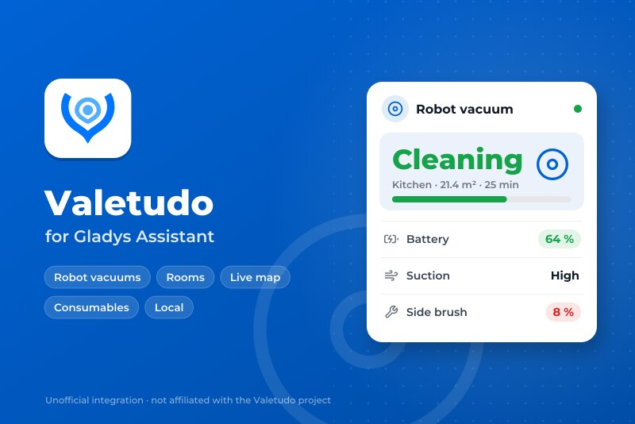
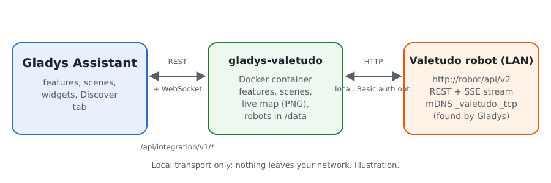
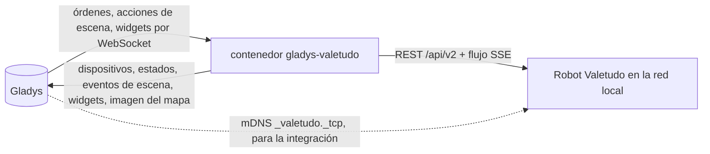
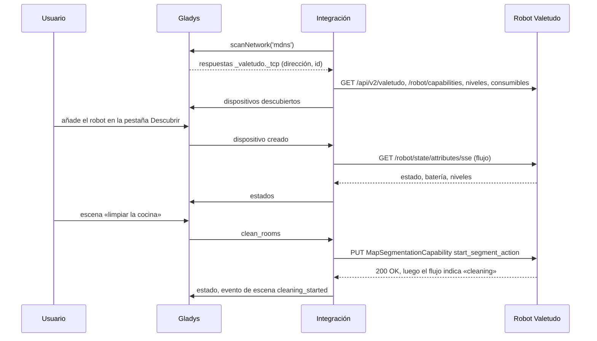
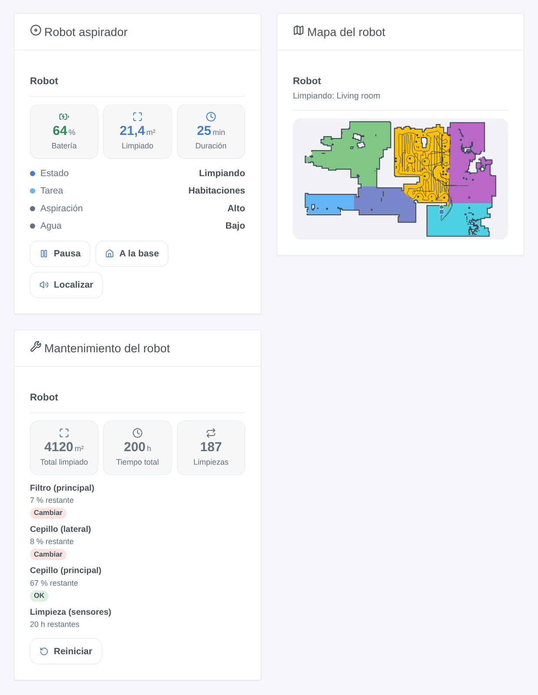

# Gladys Valetudo

[English](README.md) · [Français](README.fr.md) · [Deutsch](README.de.md) · **Español**

[](LICENSE)
[](https://github.com/William-De71/gladys-valetudo/releases)
[](https://github.com/William-De71/gladys-valetudo/actions/workflows/release.yml)
[](https://gladysassistant.com)



Integración externa para [Gladys Assistant](https://gladysassistant.com) de los robots aspiradores que funcionan con **[Valetudo](https://valetudo.cloud)**, el firmware libre que los independiza de la nube del fabricante. Inicie, pause y envíe el robot a su base, limpie habitaciones por su nombre desde sus escenas, sígalo en directo con su mapa en el panel y sepa cuándo hay que cambiar un cepillo o un filtro, todo en la red local.

Documentación de usuario: [English](docs/en.md) · [Français](docs/fr.md) · [Deutsch](docs/de.md) · [Español](docs/es.md).

Sin relación con el proyecto Valetudo. **Todavía no probada con un robot real**: las peticiones siguen la API REST oficial de Valetudo (leída en su código fuente, versión 2026.10.0) y las pruebas se ejecutan con robots simulados y un mapa real del conjunto de pruebas de Valetudo. Se agradecen los comentarios.

## Funciones

- **Un dispositivo de Gladys por robot**, con las funciones nativas de robot aspirador de Gladys: estado (limpiando, en pausa, volviendo, cargando, en la base, error…), modo de funcionamiento (limpiar, detener, cartografiar), vuelta a la base, batería y, según el robot, niveles de aspiración, de agua y de modo, y la vida restante de cada consumible.
- **Actualización en directo**: Valetudo envía cada cambio (Server-Sent Events); una comprobación cada minuto lee además sus eventos, consumibles y estadísticas.
- **2 acciones de escena**: limpiar habitaciones por nombre o número (pasadas, y aspiración y agua antes) y controlar el robot (iniciar, pausar, detener, volver a la base, localizar, vaciar el depósito, lavar o secar la mopa en la base).
- **6 desencadenantes de escena**: limpieza iniciada, limpieza terminada (superficie y duración), error (con el mensaje del robot), requiere atención (depósito de polvo lleno, consumible gastado, mopa, depósito de agua ausente, cambio de mapa por aceptar), deja de responder, vuelve a responder.
- **3 widgets del panel**: el robot (estado, batería, limpieza en curso, botones, formulario «Limpiar habitación»), su **mapa en directo** (habitaciones, trayecto, robot, base, habitación en limpieza) y su mantenimiento (consumibles, estadísticas totales, reinicio).
- **Descubrimiento** por mDNS (Valetudo se anuncia) o por direcciones escritas; un robot se sigue por su identificador de Valetudo cuando cambia su dirección. Autenticación HTTP Basic opcional.
- Cuatro idiomas: inglés, francés, alemán, español.

## Funcionamiento





De la búsqueda a una orden:



La propia integración dibuja el mapa (un PNG pequeño, sin biblioteca de imágenes) cuando un widget de mapa lo pide, como mucho cada 30 segundos.

### Transporte

`transports: ["local"]`: cada orden y cada estado van por HTTP en la red local; nada sale de ella. La insignia de Gladys de cada dispositivo indica **local**, o **inaccesible** cuando el robot deja de responder. Gladys hace la búsqueda mDNS en nombre del contenedor (manifiesto `network_discovery`), ya que Docker deja fuera el multicast.

## Dispositivos y funciones

| Función          | Categoría / tipo                 | Valores                                                      | Releída |
| ---------------- | -------------------------------- | ------------------------------------------------------------ | ------- |
| Estado           | `vacuum-cleaner` / `state`       | 0 detenido … 3 error, 4 volviendo, 5 cargando, 6 en la base  | sí      |
| Limpieza         | `vacuum-cleaner` / `run-mode`    | 0 detener, 1 limpiar (o reanudar), 2 cartografiar (si puede) | sí      |
| Volver a la base | `vacuum-cleaner` / `dock`        | 1 envía el robot a su base                                   | no      |
| Batería          | `battery` / `integer`            | %                                                            | sí      |
| Aspiración       | `text` / `select`                | los niveles del robot (`low`, `max`, `turbo`…)               | sí      |
| Agua             | `text` / `select`                | los niveles de agua (robots que friegan)                     | sí      |
| Modo             | `text` / `select`                | `vacuum`, `mop`, `vacuum_and_mop`… (si se ofrece)            | sí      |
| Consumible       | `maintenance` / `life-remaining` | % restante, uno por consumible que lo indique                | sí      |

Las funciones dependen de lo que Valetudo ofrece para el robot (sus capacidades): un robot sin control del agua no tiene la función Agua.

## Escenas y widgets

| Tipo           | Clave               | Uso                                                                                              |
| -------------- | ------------------- | ------------------------------------------------------------------------------------------------ |
| Acción         | `clean_rooms`       | habitaciones por nombre o número, pasadas, aspiración y agua opcionales; salida: habitaciones    |
| Acción         | `control`           | iniciar, pausar, detener, volver a la base, localizar, vaciar el depósito, lavar o secar la mopa |
| Desencadenante | `cleaning_started`  | empieza una limpieza o una pasada de cartografía (no una reanudación)                            |
| Desencadenante | `cleaning_finished` | una limpieza termina sin error; superficie (m²) y duración (min)                                 |
| Desencadenante | `error`             | el robot pasa a su estado de error, con su mensaje                                               |
| Desencadenante | `attention_needed`  | depósito de polvo lleno, consumible gastado, mopa, recurso ausente, cambio de mapa               |
| Desencadenante | `unreachable`       | un robot deja de responder dos veces seguidas                                                    |
| Desencadenante | `reachable_again`   | vuelve a responder                                                                               |
| Widget         | `robot`             | estado, batería, limpieza en curso, iniciar/pausar, base, localizar, limpiar habitación          |
| Widget         | `map`               | el mapa en directo, con la habitación en limpieza resaltada                                      |
| Widget         | `maintenance`       | consumibles con insignias, estadísticas totales, formulario de reinicio                          |

Ejemplos: cuando todos salen de casa, limpiar la cocina y el salón dos veces; cuando termina la limpieza, enviar una notificación con la superficie limpiada; cuando el depósito de polvo está lleno, hacer parpadear una luz del recibidor.



## Requisitos

- Gladys Assistant **5.3.0** o posterior (las versiones anteriores no pueden instalar la integración).
- Un robot aspirador con Valetudo (consulte [los robots compatibles](https://valetudo.cloud/pages/general/supported-robots.html)), en la red de Gladys. Las habitaciones requieren un robot con segmentación por habitaciones; el widget de mapa requiere un mapa guardado.

## Instalación

- **Desde la tienda**: Integraciones → Valetudo → Instalar.
- **Desde la URL del repositorio**: Integraciones → integración externa → `https://github.com/William-De71/gladys-valetudo`.
- **Modo desarrollador**: ejecute `npm start` con las variables que da Gladys (ver Desarrollo).

## Configuración

| Campo                                       | Por defecto | Uso                                                                                      |
| ------------------------------------------- | ----------- | ---------------------------------------------------------------------------------------- |
| Encontrar los robots automáticamente (mDNS) | activado    | escucha los anuncios de Valetudo en la red local                                         |
| Direcciones de los robots (opcional)        | vacío       | robots a los que no llega el mDNS, `IP` o `nombre`, con `:puerto`                        |
| Usuario, Contraseña                         | vacío       | solo si la autenticación HTTP está activada en Valetudo                                  |
| Idioma de los textos de los dispositivos    | inglés      | nombres de funciones y opciones, mensajes de los desencadenantes, errores de las escenas |

El botón **Buscar y probar los robots** vuelve a buscar y lista cada robot encontrado con su dirección y su batería.

## Uso

1. Configure y pulse **Buscar y probar los robots**.
2. Abra la pestaña **Descubrir** y añada sus robots.
3. Use las funciones en el panel, añada los widgets **Robot aspirador**, **Mapa del robot** y **Mantenimiento del robot**, y cree escenas con las acciones y desencadenantes de arriba.

## Desarrollo

```bash
npm install
npm test                       # node --test, robots simulados, nunca la red
npm run lint                   # ESLint
npm run format:check           # Prettier
npx github:GladysAssistant/integration-store . --skip-image-check
scripts/build-cover.sh         # cover.jpg desde docs/assets/cover.svg
docs/illustrations/render.sh   # docs/assets/widgets.<idioma>.png
```

En local, el SDK lee `GLADYS_HOST_API_URL`, `GLADYS_INTEGRATION_TOKEN` y `GLADYS_INTEGRATION_SELECTOR` (que da Gladys en modo desarrollador); `VALETUDO_DATA_DIR` cambia `/data` de sitio. `DEBUG=gladys-integration-sdk` muestra los registros del SDK.

Las pruebas cubren el cliente HTTP (rutas y cuerpos de las órdenes, autenticación Basic, el analizador SSE), las respuestas mDNS, la conversión de estados, la imagen del mapa, el dispositivo de la pestaña Descubrir (fijado en `test/fixtures/discovery.baseline.json`), los widgets (`validateWidgetContent`, `validateWidgetImage`), el manifiesto, los cuatro idiomas, el script de publicación y toda la integración frente al Gladys simulado del SDK. `test/structure.test.js` congela cada clave que guardan los usuarios.

## Proceso de publicación


Cada fusión en `main` lanza la CI y luego calcula la versión a partir de los [Conventional Commits](https://www.conventionalcommits.org/) desde la última etiqueta: `feat` → menor, `fix` / `perf` → parche, `!` o `BREAKING CHANGE` → mayor (una menor por debajo de 1.0.0); `docs`, `chore`, `ci`, `test`, `style`, `refactor`, `build` solos no publican nada. Se genera la sección del changelog, se envía la etiqueta, se construye la imagen multiarquitectura, luego `main` recibe el commit de publicación, se crea la GitHub Release y un último job comprueba la imagen pública, el validador de la tienda y el topic.

- El título de la pull request se convierte en el commit de squash y luego en la línea del changelog: escríbalo en inglés, para el usuario (`pr-title.yml` lo comprueba). No edite nunca `CHANGELOG.md` a mano.
- La 1.0.0 es una decisión: Actions → Release → Run workflow con `release-as: 1.0.0`. `dry-run` muestra la versión y las notas sin publicar.
- **Rama protegida**: la publicación envía su commit a `main` con `GITHUB_TOKEN`. El ruleset `protect-main` (sin borrado, sin force-push) lo deja pasar; una regla más estricta (pull request obligatoria, status checks) necesitaría GitHub Actions en la lista de excepciones, o una GitHub App.
- Tras la primera publicación, haga público el paquete de `ghcr.io` (Package settings → Change visibility); si no, Gladys no puede descargarlo.

## Solución de problemas

Ver [docs/es.md](docs/es.md#solución-de-problemas). Informe de los problemas con las versiones de Gladys, de la integración y de Valetudo, el modelo del robot y el mensaje de **Buscar y probar los robots**.

## Contribuir

Las issues y pull requests son bienvenidas, sobre todo de quienes tienen un robot con Valetudo: el resultado con un robot real (lo que funciona y lo que no) ayuda mucho. Ejecute `npm run format:check && npm run lint && npm test` antes de abrir una pull request y no cambie ninguna clave guardada (ver [CLAUDE.md](CLAUDE.md)).

## Seguridad

Ver [SECURITY.md](SECURITY.md): informe de las vulnerabilidades en privado. Sin autenticación, cualquiera en su red puede manejar el robot a través de Valetudo: active su autenticación HTTP si su red no es de confianza y dé las mismas credenciales a la integración.

## Capturas pendientes

Las imágenes de arriba son ilustraciones, no capturas de pantalla. Las capturas reales irán en `docs/assets/screenshots/` (PNG, 1280 × 800): `configuration.png` (la configuración con su estado), `discover.png` (un robot en la pestaña Descubrir), `dashboard.png` (las funciones y los tres widgets en un panel), `map.png` (el widget de mapa de un robot real durante una limpieza).

## Licencia

[Licencia Apache 2.0](LICENSE) — ver también [NOTICE](NOTICE). Valetudo lo desarrollan Hypfer y sus colaboradores; esta integración no está afiliada, respaldada ni patrocinada por el proyecto. El mapa de prueba `test/fixtures/map.json` y el logotipo de la portada proceden del [repositorio de Valetudo](https://github.com/Hypfer/Valetudo) (Apache-2.0). Roborock, Dreame, Xiaomi y los demás nombres son marcas de sus propietarios. Gracias a la documentación y al SDK de Gladys, y al proyecto Valetudo por su API abierta y documentada.
