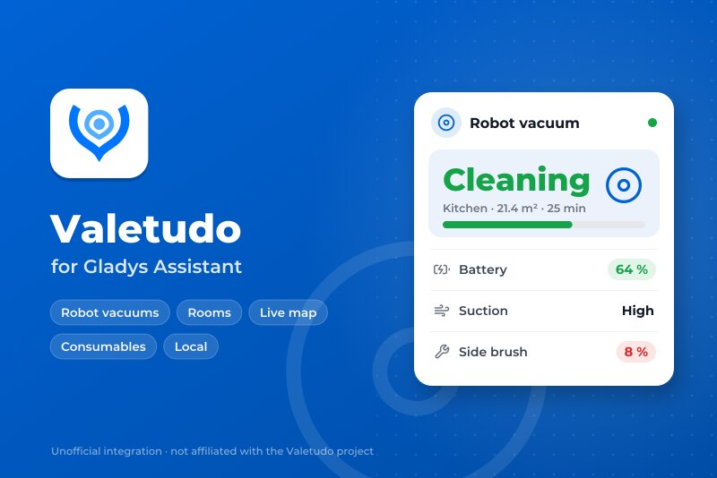
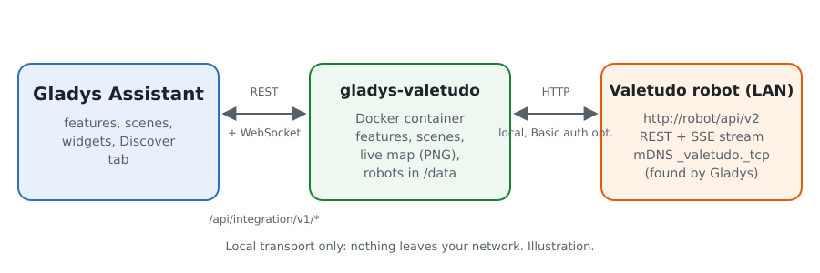
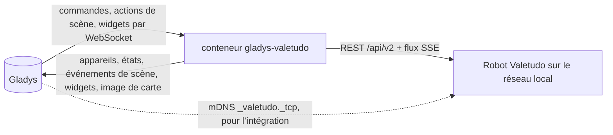
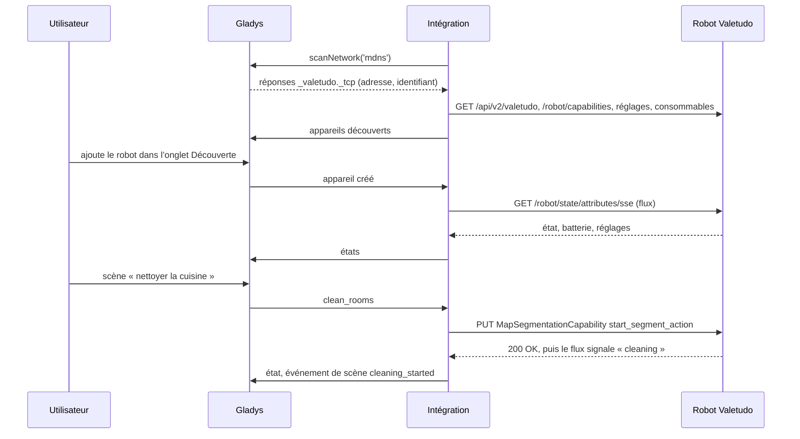
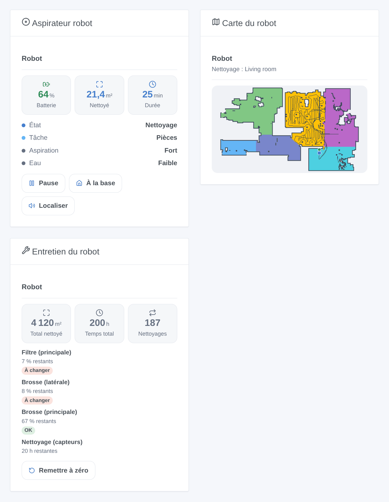

# Gladys Valetudo

[English](README.md) · **Français** · [Deutsch](README.de.md) · [Español](README.es.md)

[](LICENSE)
[](https://github.com/William-De71/gladys-valetudo/releases)
[](https://github.com/William-De71/gladys-valetudo/actions/workflows/release.yml)
[](https://gladysassistant.com)



Intégration externe pour [Gladys Assistant](https://gladysassistant.com) des aspirateurs robots sous **[Valetudo](https://valetudo.cloud)**, le micrologiciel libre qui les affranchit du cloud du fabricant. Démarrez, mettez en pause et renvoyez le robot à sa base, nettoyez des pièces par leur nom depuis vos scènes, suivez-le en direct avec sa carte sur le tableau de bord et sachez quand changer une brosse ou un filtre, le tout sur le réseau local.

Documentation utilisateur : [English](docs/en.md) · [Français](docs/fr.md) · [Deutsch](docs/de.md) · [Español](docs/es.md).

Sans lien avec le projet Valetudo. **Pas encore testée sur un vrai robot** : les requêtes suivent l’API REST officielle de Valetudo (lue dans son code source, version 2026.10.0) et les tests tournent contre des robots simulés et une vraie carte issue des tests de Valetudo. Vos retours sont les bienvenus.

## Fonctionnalités

- **Un appareil Gladys par robot**, avec les fonctionnalités natives d’aspirateur robot de Gladys : état (nettoyage, pause, retour, en charge, sur la base, erreur…), mode (nettoyer, arrêter, cartographier), retour à la base, batterie, et selon le robot les réglages d’aspiration, d’eau et de mode et la durée de vie restante de chaque consommable.
- **Mises à jour en direct** : Valetudo pousse chaque changement (Server-Sent Events) ; une vérification chaque minute relit aussi ses événements, consommables et statistiques.
- **2 actions de scène** : nettoyer des pièces par nom ou numéro (passages, aspiration et eau d’abord), et piloter le robot (démarrer, pause, arrêter, retour à la base, localiser, vider le bac, laver ou sécher la serpillière à la station).
- **6 déclencheurs** : nettoyage démarré, nettoyage terminé (surface et durée), erreur (avec le message du robot), demande votre attention (bac plein, consommable usé, serpillière, réservoir manquant, changement de carte à accepter), ne répond plus, répond de nouveau.
- **3 widgets** : le robot (état, batterie, nettoyage en cours, boutons, formulaire « Nettoyer une pièce »), sa **carte en direct** (pièces, trajet, robot, base, pièce en cours) et son entretien (consommables, statistiques, remise à zéro).
- **Découverte** par mDNS (Valetudo s’annonce) ou adresses saisies ; un robot est suivi par son identifiant Valetudo quand son adresse change. Authentification HTTP Basic facultative.
- Quatre langues : anglais, français, allemand, espagnol.

## Fonctionnement





De la recherche à une commande :



La carte est dessinée par l’intégration elle-même (un petit PNG, sans bibliothèque d’images) quand un widget de carte la demande, au plus toutes les 30 secondes.

### Transport

`transports: ["local"]` : chaque commande et chaque état passent en HTTP sur le réseau local, rien n’en sort. Le badge Gladys de chaque appareil affiche **local**, ou **injoignable** quand le robot ne répond plus. La recherche mDNS est faite par Gladys pour le compte du conteneur (`network_discovery` du manifeste), car Docker ne laisse pas passer le multicast jusqu’à lui.

## Appareils et fonctionnalités

| Fonctionnalité   | Catégorie / type                 | Valeurs                                                           | Relue |
| ---------------- | -------------------------------- | ----------------------------------------------------------------- | ----- |
| État             | `vacuum-cleaner` / `state`       | 0 arrêté … 3 erreur, 4 retour, 5 en charge, 6 sur la base         | oui   |
| Nettoyage        | `vacuum-cleaner` / `run-mode`    | 0 arrêt, 1 nettoyer (ou reprendre), 2 cartographier (si possible) | oui   |
| Retour à la base | `vacuum-cleaner` / `dock`        | 1 renvoie le robot sur sa base                                    | non   |
| Batterie         | `battery` / `integer`            | %                                                                 | oui   |
| Aspiration       | `text` / `select`                | les réglages du robot (`low`, `max`, `turbo`…)                    | oui   |
| Eau              | `text` / `select`                | les réglages d’eau (robots laveurs)                               | oui   |
| Mode             | `text` / `select`                | `vacuum`, `mop`, `vacuum_and_mop`… (si proposé)                   | oui   |
| Consommable      | `maintenance` / `life-remaining` | % restant, un par consommable qui le remonte                      | oui   |

Les fonctionnalités dépendent de ce que Valetudo propose pour le robot (ses capacités) : un robot sans réglage d’eau n’a pas de fonctionnalité Eau.

## Scènes et widgets

| Type        | Clé                 | Usage                                                                                   |
| ----------- | ------------------- | --------------------------------------------------------------------------------------- |
| Action      | `clean_rooms`       | pièces par nom ou numéro, passages, aspiration et eau facultatives ; sortie : pièces    |
| Action      | `control`           | démarrer, pause, arrêter, base, localiser, vider le bac, laver ou sécher la serpillière |
| Déclencheur | `cleaning_started`  | un nettoyage ou une cartographie démarre (pas une reprise)                              |
| Déclencheur | `cleaning_finished` | un nettoyage se termine sans erreur ; surface (m²) et durée (min)                       |
| Déclencheur | `error`             | le robot passe en erreur, avec son message                                              |
| Déclencheur | `attention_needed`  | bac plein, consommable usé, serpillière, élément manquant, changement de carte          |
| Déclencheur | `unreachable`       | un robot ne répond plus deux fois de suite                                              |
| Déclencheur | `reachable_again`   | il répond de nouveau                                                                    |
| Widget      | `robot`             | état, batterie, nettoyage en cours, démarrer/pause, base, localiser, pièce              |
| Widget      | `map`               | la carte en direct, la pièce en cours en surbrillance                                   |
| Widget      | `maintenance`       | consommables avec pastilles, statistiques, formulaire de remise à zéro                  |

Exemples : quand tout le monde quitte la maison, nettoyer la cuisine et le salon en deux passages ; quand le nettoyage est terminé, envoyer une notification avec la surface nettoyée ; quand le bac à poussière est plein, faire clignoter une lampe de l’entrée.



## Prérequis

- Gladys Assistant **5.3.0** ou plus récent (les versions plus anciennes ne peuvent pas installer l’intégration).
- Un aspirateur robot sous Valetudo (voir [les robots pris en charge](https://valetudo.cloud/pages/general/supported-robots.html)), sur le réseau de Gladys. Le nettoyage par pièce demande un robot qui découpe la carte en pièces ; le widget de carte demande une carte enregistrée.

## Installation

- **Depuis le store** : Intégrations → Valetudo → Installer.
- **Depuis l’URL du dépôt** : Intégrations → intégration externe → `https://github.com/William-De71/gladys-valetudo`.
- **Mode développeur** : lancez `npm start` avec les variables données par Gladys (voir Développement).

## Configuration

| Champ                                     | Défaut  | Usage                                                             |
| ----------------------------------------- | ------- | ----------------------------------------------------------------- |
| Trouver les robots automatiquement (mDNS) | activé  | écoute les annonces de Valetudo sur le réseau local               |
| Adresses des robots                       | vide    | robots que le mDNS n’atteint pas, `IP` ou `nom`, avec `:port`     |
| Nom d’utilisateur, mot de passe           | vide    | seulement si l’authentification HTTP est activée dans Valetudo    |
| Langue des textes des appareils           | anglais | noms des fonctionnalités et options, messages, erreurs des scènes |

Le bouton **Rechercher et tester les robots** relance la recherche et liste chaque robot trouvé avec son adresse et sa batterie.

## Utilisation

1. Configurez, puis cliquez sur **Rechercher et tester les robots**.
2. Ouvrez l’onglet **Découverte** et ajoutez vos robots.
3. Utilisez les fonctionnalités sur le tableau de bord, ajoutez les widgets **Aspirateur robot**, **Carte du robot** et **Entretien du robot**, et construisez des scènes avec les actions et déclencheurs ci-dessus.

## Développement

```bash
npm install
npm test                       # node --test, robots simulés, jamais le réseau
npm run lint                   # ESLint
npm run format:check           # Prettier
npx github:GladysAssistant/integration-store . --skip-image-check
scripts/build-cover.sh         # cover.jpg depuis docs/assets/cover.svg
docs/illustrations/render.sh   # docs/assets/widgets.<langue>.png
```

En local, le SDK lit `GLADYS_HOST_API_URL`, `GLADYS_INTEGRATION_TOKEN` et `GLADYS_INTEGRATION_SELECTOR` (donnés par Gladys en mode développeur) ; `VALETUDO_DATA_DIR` déplace `/data`. `DEBUG=gladys-integration-sdk` affiche les journaux du SDK.

Les tests couvrent le client HTTP (chemins et corps des commandes, authentification Basic, lecteur SSE), les réponses mDNS, la correspondance des états, l’image de la carte, l’appareil de l’onglet Découverte (figé dans `test/fixtures/discovery.baseline.json`), les widgets (`validateWidgetContent`, `validateWidgetImage`), le manifeste, les quatre langues, le script de release, et toute l’intégration face au faux Gladys du SDK. `test/structure.test.js` fige chaque clé que les utilisateurs enregistrent.

## Processus de release


Chaque fusion sur `main` lance la CI, puis calcule la version depuis les [Conventional Commits](https://www.conventionalcommits.org/) du dernier tag : `feat` → mineure, `fix` / `perf` → correctif, `!` ou `BREAKING CHANGE` → majeure (une mineure sous 1.0.0) ; `docs`, `chore`, `ci`, `test`, `style`, `refactor`, `build` seuls ne publient rien. La section du changelog est générée, le tag poussé, l’image multi-architecture construite, puis `main` reçoit le commit de release, la GitHub Release est créée et un dernier job vérifie l’image publique, le validateur du store et le topic.

- Le titre de la pull request devient le commit de squash, puis la ligne du changelog : écrivez-le en anglais, pour l’utilisateur (`pr-title.yml` le vérifie). Ne modifiez jamais `CHANGELOG.md` à la main.
- La 1.0.0 est une décision : Actions → Release → Run workflow avec `release-as: 1.0.0`. `dry-run` affiche la version et les notes sans rien publier.
- **Branche protégée** : la release pousse son commit sur `main` avec `GITHUB_TOKEN`. Le ruleset `protect-main` (ni suppression, ni force-push) le laisse passer ; une règle plus stricte (pull request obligatoire, status checks) demanderait GitHub Actions dans la liste de contournement, ou une GitHub App.
- Après la première release, rendez public le package `ghcr.io` (Package settings → Change visibility), sinon Gladys ne peut pas le télécharger.

## Dépannage

Voir [docs/fr.md](docs/fr.md#dépannage). Signalez un problème avec les versions de Gladys, de l’intégration et de Valetudo, le modèle du robot, et le message de **Rechercher et tester les robots**.

## Contribuer

Issues et pull requests sont les bienvenues, surtout de la part des possesseurs d’un robot sous Valetudo : le résultat sur un vrai robot (ce qui marche, ce qui ne marche pas) aide beaucoup. Lancez `npm run format:check && npm run lint && npm test` avant d’ouvrir une pull request, et ne changez aucune clé enregistrée (voir [CLAUDE.md](CLAUDE.md)).

## Sécurité

Voir [SECURITY.md](SECURITY.md) : signalez les failles en privé. Sans authentification, n’importe qui sur votre réseau peut piloter le robot par Valetudo : activez son authentification HTTP si votre réseau n’est pas de confiance, et donnez les mêmes identifiants à l’intégration.

## Captures à venir

Les images ci-dessus sont des illustrations, pas des captures d’écran. Les vraies captures iront dans `docs/assets/screenshots/` (PNG, 1280 × 800) : `configuration.png` (la configuration avec son état), `discover.png` (un robot dans l’onglet Découverte), `dashboard.png` (les fonctionnalités et les trois widgets sur un tableau de bord), `map.png` (le widget de carte d’un vrai robot en plein nettoyage).

## Licence

[Licence Apache 2.0](LICENSE) — voir aussi [NOTICE](NOTICE). Valetudo est développé par Hypfer et ses contributeurs ; cette intégration n’est ni affiliée, ni approuvée, ni sponsorisée par ce projet. La carte de test `test/fixtures/map.json` et le logo de la couverture viennent du [dépôt Valetudo](https://github.com/Hypfer/Valetudo) (Apache-2.0). Roborock, Dreame, Xiaomi et les autres noms sont des marques de leurs propriétaires. Merci à la documentation et au SDK de Gladys, et au projet Valetudo pour son API ouverte et documentée.
