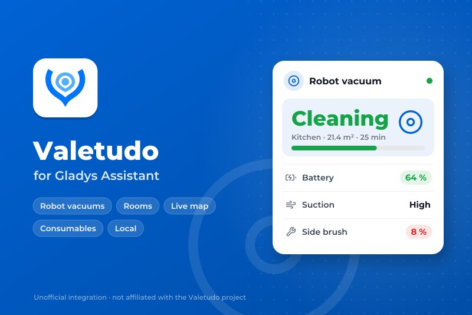
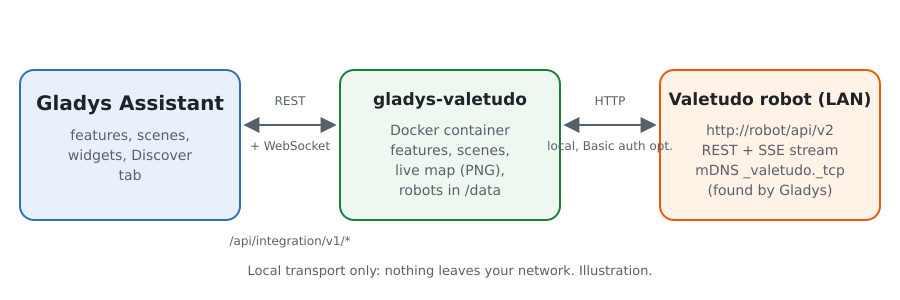
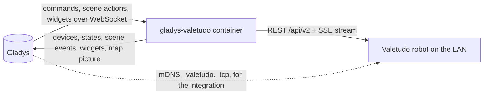
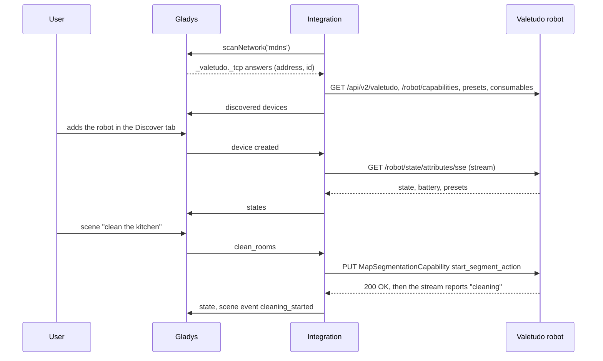
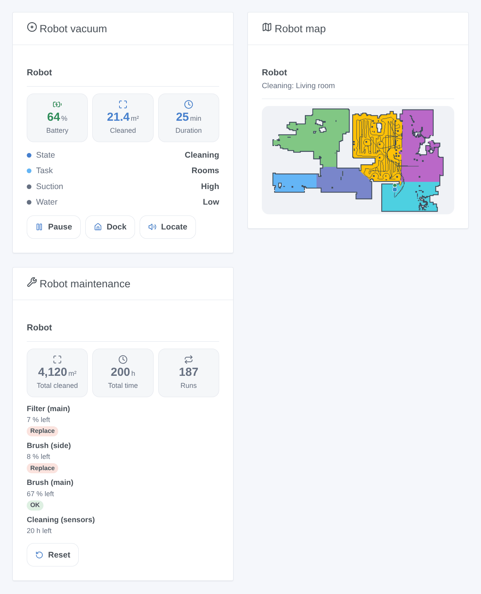

# Gladys Valetudo

**English** · [Français](README.fr.md) · [Deutsch](README.de.md) · [Español](README.es.md)

[](LICENSE)
[](https://github.com/William-De71/gladys-valetudo/releases)
[](https://github.com/William-De71/gladys-valetudo/actions/workflows/release.yml)
[](https://gladysassistant.com)



[Gladys Assistant](https://gladysassistant.com) external integration for robot vacuums running **[Valetudo](https://valetudo.cloud)**, the open firmware that frees them from the manufacturer cloud. Start, pause and dock the robot, clean rooms by name from your scenes, follow it live with its map on the dashboard and know when a brush or a filter needs replacing, all on the local network.

User documentation: [English](docs/en.md) · [Français](docs/fr.md) · [Deutsch](docs/de.md) · [Español](docs/es.md).

Not affiliated with the Valetudo project. **Not tested on a real robot yet**: the requests follow the official REST API of Valetudo (read from its source, version 2026.10.0) and the tests run against fake robots and a real map from the Valetudo test suite. Feedback welcome.

## Features

- **One Gladys device per robot**, with the native robot vacuum features of Gladys: state (cleaning, paused, returning, charging, docked, error…), run mode (clean, stop, map), back to the dock, battery, and, depending on the robot, suction, water and mode presets and the remaining life of each consumable.
- **Live updates**: Valetudo pushes every change (Server-Sent Events); a check every minute also reads its events, consumables and statistics.
- **2 scene actions**: clean rooms by name or number (passes, suction and water first), and control the robot (start, pause, stop, dock, locate, empty the bin, wash or dry the mop at the dock).
- **6 scene triggers**: cleaning started, cleaning finished (area and duration), error (with the message of the robot), attention needed (dust bin full, consumable worn out, mop pad, missing water tank, map change to accept), not answering, answering again.
- **3 dashboard widgets**: the robot (state, battery, current run, buttons, "Clean a room" form), its **live map** (rooms, path, robot, dock, room being cleaned) and its maintenance (consumables, lifetime statistics, reset).
- **Discovery** by mDNS (Valetudo announces itself) or typed addresses; a robot is followed by its Valetudo id when its address changes. Optional HTTP Basic authentication.
- Four languages: English, French, German, Spanish.

## How it works





From the search to a command:



The map is drawn by the integration itself (a small PNG, no image library) when a map widget asks for it, at most every 30 seconds.

### Transport

`transports: ["local"]`: every command and state goes over HTTP on the local network, nothing leaves it. The Gladys badge of each device shows **local**, or **unreachable** when the robot stops answering. The mDNS search is done by Gladys on behalf of the container (manifest `network_discovery`), as Docker keeps multicast out of it.

## Devices and features

| Feature    | Category / type                  | Values                                                 | Read back |
| ---------- | -------------------------------- | ------------------------------------------------------ | --------- |
| State      | `vacuum-cleaner` / `state`       | 0 stopped … 3 error, 4 returning, 5 charging, 6 docked | yes       |
| Cleaning   | `vacuum-cleaner` / `run-mode`    | 0 stop, 1 clean (or resume), 2 map (if supported)      | yes       |
| Dock       | `vacuum-cleaner` / `dock`        | 1 sends the robot back to its dock                     | no        |
| Battery    | `battery` / `integer`            | %                                                      | yes       |
| Suction    | `text` / `select`                | the presets of the robot (`low`, `max`, `turbo`…)      | yes       |
| Water      | `text` / `select`                | the water presets (mopping robots)                     | yes       |
| Mode       | `text` / `select`                | `vacuum`, `mop`, `vacuum_and_mop`… (if offered)        | yes       |
| Consumable | `maintenance` / `life-remaining` | % left, one per consumable that reports it             | yes       |

The features depend on what Valetudo offers for the robot (its capabilities): a robot without water control gets no Water feature.

## Scenes and widgets

| Kind    | Key                 | Use                                                                        |
| ------- | ------------------- | -------------------------------------------------------------------------- |
| Action  | `clean_rooms`       | rooms by name or number, passes, optional suction and water; output: rooms |
| Action  | `control`           | start, pause, stop, dock, locate, empty the bin, wash or dry the mop       |
| Trigger | `cleaning_started`  | a run or mapping pass starts (not a resume)                                |
| Trigger | `cleaning_finished` | a run ends without error; area (m²) and duration (min)                     |
| Trigger | `error`             | the robot enters its error state, with its message                         |
| Trigger | `attention_needed`  | dust bin full, consumable worn out, mop pad, missing resource, map change  |
| Trigger | `unreachable`       | a robot stopped answering twice in a row                                   |
| Trigger | `reachable_again`   | it answers again                                                           |
| Widget  | `robot`             | state, battery, current run, start/pause, dock, locate, clean a room       |
| Widget  | `map`               | the live map, the room being cleaned highlighted                           |
| Widget  | `maintenance`       | consumables with badges, lifetime statistics, reset form                   |

Examples: when everybody leaves home, clean the kitchen and the living room twice; when the cleaning is finished, send a notification with the area cleaned; when the dust bin is full, flash a light in the hall.



## Requirements

- Gladys Assistant **5.3.0** or later (older versions cannot install the integration).
- A robot vacuum running Valetudo (see [the supported robots](https://valetudo.cloud/pages/general/supported-robots.html)), on the network of Gladys. Rooms need a robot with room segmentation; the map widget needs a saved map.

## Installation

- **From the store**: Integrations → Valetudo → Install.
- **From the repository URL**: Integrations → external integration → `https://github.com/William-De71/gladys-valetudo`.
- **Developer mode**: run `npm start` with the variables given by Gladys (see Development).

## Configuration

| Field                                | Default | Use                                                        |
| ------------------------------------ | ------- | ---------------------------------------------------------- |
| Find the robots automatically (mDNS) | on      | listens to the Valetudo announcements on the local network |
| Robot addresses                      | empty   | robots mDNS does not reach, `IP` or `name`, with `:port`   |
| User name, password                  | empty   | only when HTTP authentication is on in Valetudo            |
| Language of the device texts         | English | feature and option names, trigger messages, scene errors   |

The **Search and test the robots** button searches again and lists every robot found with its address and battery.

## Usage

1. Configure, then click **Search and test the robots**.
2. Open the **Discover** tab and add your robots.
3. Use the features on the dashboard, add the **Robot vacuum**, **Robot map** and **Robot maintenance** widgets, and build scenes with the actions and triggers above.

## Development

```bash
npm install
npm test                       # node --test, fake robots, never the network
npm run lint                   # ESLint
npm run format:check           # Prettier
npx github:GladysAssistant/integration-store . --skip-image-check
scripts/build-cover.sh         # cover.jpg from docs/assets/cover.svg
docs/illustrations/render.sh   # docs/assets/widgets.<lang>.png
```

Locally, the SDK reads `GLADYS_HOST_API_URL`, `GLADYS_INTEGRATION_TOKEN` and `GLADYS_INTEGRATION_SELECTOR` (given by Gladys in developer mode); `VALETUDO_DATA_DIR` moves `/data`. `DEBUG=gladys-integration-sdk` shows the SDK logs.

The tests cover the HTTP client (paths and bodies of the commands, Basic authentication, the SSE parser), the mDNS answers, the state mapping, the map picture, the device of the Discover tab (pinned in `test/fixtures/discovery.baseline.json`), the widgets (`validateWidgetContent`, `validateWidgetImage`), the manifest, the four languages, the release script, and the whole integration against the fake Gladys of the SDK. `test/structure.test.js` freezes every key users store.

## Release process


Every merge on `main` runs the CI, then computes the version from the [Conventional Commits](https://www.conventionalcommits.org/) since the last tag: `feat` → minor, `fix` / `perf` → patch, `!` or `BREAKING CHANGE` → major (a minor below 1.0.0); `docs`, `chore`, `ci`, `test`, `style`, `refactor`, `build` alone publish nothing. The changelog section is generated, the tag pushed, the multi-architecture image built, then `main` receives the release commit, the GitHub Release is created and a last job checks the public image, the store validator and the topic.

- The pull request title becomes the squash commit, then the changelog line: write it in English, for the user (`pr-title.yml` checks it). Never edit `CHANGELOG.md` by hand.
- 1.0.0 is a decision: Actions → Release → Run workflow with `release-as: 1.0.0`. `dry-run` shows the version and the notes without publishing.
- **Protected branch**: the release pushes its commit to `main` with `GITHUB_TOKEN`. The `protect-main` ruleset (no deletion, no force-push) lets it through; a stricter rule (pull request required, status checks) would need GitHub Actions in its bypass list, or a GitHub App.
- After the first release, make the `ghcr.io` package public (Package settings → Change visibility), or Gladys cannot pull it.

## Troubleshooting

See [docs/en.md](docs/en.md#troubleshooting). Report issues with the versions of Gladys, of the integration and of Valetudo, the model of the robot, and the message of **Search and test the robots**.

## Contributing

Issues and pull requests are welcome, especially from owners of a Valetudo robot: the result on a real robot (what works, what does not) helps a lot. Run `npm run format:check && npm run lint && npm test` before opening a pull request, and keep every stored key unchanged (see [CLAUDE.md](CLAUDE.md)).

## Security

See [SECURITY.md](SECURITY.md): report vulnerabilities privately. Without authentication, anyone on your network can drive the robot through Valetudo: turn on its HTTP authentication if your network is not trusted, and give the same credentials to the integration.

## Screenshots to come

The images above are illustrations, not screenshots. Real screenshots will go in `docs/assets/screenshots/` (PNG, 1280 × 800): `configuration.png` (the configuration with its status), `discover.png` (a robot in the Discover tab), `dashboard.png` (the features and the three widgets on a dashboard), `map.png` (the map widget of a real robot while cleaning).

## License

[Apache License 2.0](LICENSE) — see also [NOTICE](NOTICE). Valetudo is developed by Hypfer and its contributors; this integration is not affiliated with, endorsed or sponsored by it. The test map `test/fixtures/map.json` and the logo in the cover come from the [Valetudo repository](https://github.com/Hypfer/Valetudo) (Apache-2.0). Roborock, Dreame, Xiaomi and the other names are trademarks of their owners. Thanks to the Gladys documentation and SDK, and to the Valetudo project for its open, documented API.
