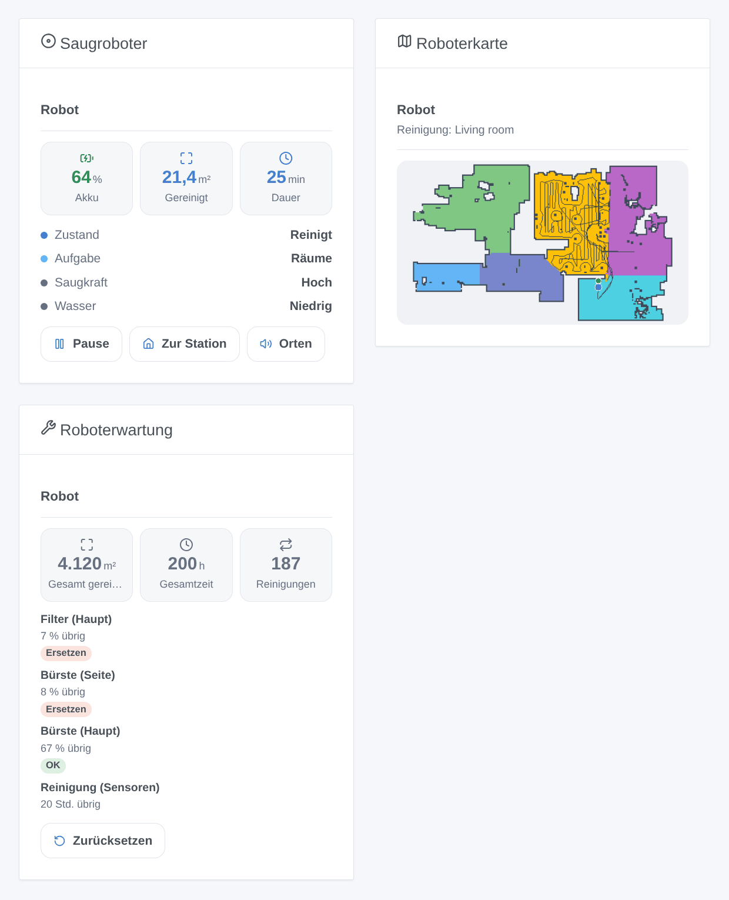

# Valetudo

## Überblick

Diese Integration steuert Saugroboter mit **Valetudo** (valetudo.cloud), der offenen Firmware, die die Cloud des Herstellers ersetzt, über ihre offizielle lokale REST-API: kein Konto, nichts verlässt dein Netzwerk. Jeder Roboter wird ein Gladys-Gerät mit den nativen Saugroboter-Funktionen (Zustand, Reinigung, Station, Akku), seinen Voreinstellungen für Saugkraft und Wasser und der Restlebensdauer seiner Verbrauchsmaterialien. Szenenaktionen reinigen Räume über ihren Namen und steuern den Roboter; Szenenauslöser melden, wann eine Reinigung beginnt oder endet, wann der Roboter einen Fehler hat oder dich braucht. Drei Dashboard-Widgets zeigen den Roboter, seine Live-Karte und seine Wartung.

Nicht mit dem Valetudo-Projekt verbunden. **Noch nicht an einem echten Roboter getestet**: Die Anfragen folgen der offiziellen API von Valetudo 2026.10; Rückmeldungen sind willkommen.

## Voraussetzungen

- Gladys Assistant 5.3.0 oder neuer.
- Ein Saugroboter mit Valetudo im selben Netzwerk wie Gladys, dessen Valetudo-Seite sich im Browser öffnen lässt.
- Am besten eine feste IP-Adresse für den Roboter im Router. Zum Reinigen von Räumen braucht es einen Roboter mit Raumaufteilung und eine gespeicherte Karte.

## Konfiguration

1. Installiere die Integration aus dem Store und öffne ihre Konfiguration.
2. Lass **Roboter automatisch finden (mDNS)** eingeschaltet. Für einen Roboter in einem anderen Netzwerk gib seine Adresse (IP oder Name, bei Bedarf mit `:Port`) unter **Adressen der Roboter (optional)** ein.
3. Ist in Valetudo die HTTP-Authentifizierung eingeschaltet (Settings → Connectivity → Auth settings), gib denselben **Benutzernamen** und dasselbe **Passwort** ein.
4. Wähle die **Sprache der Gerätetexte** und klicke auf **Roboter suchen und testen**: Die Meldung listet jeden gefundenen Roboter mit Adresse und Akku auf.
5. Öffne den Tab **Entdecken** und füge deine Roboter hinzu.

## Verwendung

Jeder Roboter erhält diese Funktionen, je nachdem, was Valetudo für ihn anbietet:

| Funktion           | Typ                 | Was sie tut                                                                              |
| ------------------ | ------------------- | ---------------------------------------------------------------------------------------- |
| Zustand            | Saugroboter, Sensor | Gestoppt, reinigt, pausiert, Fehler, kehrt zurück, lädt, in der Station                  |
| Reinigung          | Saugroboter, Liste  | Stoppen, Reinigen (startet oder setzt fort), Kartieren (Kartierungsfahrt, falls möglich) |
| Zur Station        | Saugroboter, Taste  | Schickt den Roboter zurück zu seiner Station                                             |
| Akku               | Akku, %             | Ladestand                                                                                |
| Saugkraft          | Liste               | Die Saugkraft-Voreinstellungen des Roboters                                              |
| Wasser             | Liste               | Die Wasser-Voreinstellungen (Wischroboter)                                               |
| Modus              | Liste               | Saugen, Wischen, Saugen und Wischen… (bei Robotern, die es anbieten)                     |
| Verbrauchsmaterial | Wartung, %          | Restlebensdauer jeder Bürste, jedes Filters, Wischpads… die sie meldet                   |

Änderungen meldet Valetudo sofort; Verbrauchsmaterialien und Statistiken werden alle paar Minuten gelesen.

### Dashboard-Widgets

- **Saugroboter**: Zustand, Akku, Fläche und Dauer der laufenden Reinigung, Saugkraft und Wasser, die Fehlermeldung; Tasten **Starten** / **Pause** / **Fortsetzen**, **Zur Station**, **Orten** und **Raum reinigen** (Raum und Durchgänge wählen).
- **Roboterkarte**: die von der Integration gezeichnete Live-Karte (Räume in Farbe, Wände, Weg, Roboter in Blau, Station in Grün, virtuelle Wände und Sperrzonen in Rot), der gerade gereinigte Raum in Bernstein.
- **Roboterwartung**: Gesamtfläche, -zeit und -anzahl der Reinigungen, jedes Verbrauchsmaterial, das am stärksten verschlissene zuerst (Badge **Ersetzen** unter 10 %, **Bald** unter 25 %), und **Zurücksetzen**, nachdem du eines ersetzt hast.

### Szenen

Aktionen: **Räume mit einem Saugroboter reinigen** (Raumnamen wie in Valetudo festgelegt, Akzente sowie Groß- und Kleinschreibung egal, oder Raumnummern, durch Kommas getrennt; Durchgänge; optional vorher Saugkraft und Wasser setzen; gibt die gesendeten Räume zurück) und **Saugroboter steuern** (starten oder fortsetzen, pausieren, stoppen, zurück zur Station, orten, Behälter an der Station leeren, Mopp an der Station waschen oder trocknen).

Auslöser: **Reinigung gestartet**, **Reinigung beendet** (mit der Fläche in m² und der Dauer in Minuten), **Fehler** (mit der Meldung des Roboters), **braucht Aufmerksamkeit** (Staubbehälter voll, Verbrauchsmaterial verschlissen, Erinnerung ans Wischpad, etwas fehlt, Kartenänderung zu bestätigen; nach Grund filterbar), **antwortet nicht mehr** und **antwortet wieder**. Der Name des Roboters steht immer als Variable bereit.

Beispiele:

- Wenn alle das Haus verlassen → „Küche, Wohnzimmer“ zweimal reinigen.
- Wenn die Reinigung beendet ist → „{{triggerEvent.data.area_m2}} m² gereinigt“ an dein Handy senden.
- Wenn der Roboter Aufmerksamkeit braucht, weil der Staubbehälter voll ist → das Licht im Flur blinken lassen.

## Fehlerbehebung

- **Kein Roboter gefunden**: Prüfe, ob sich seine Valetudo-Seite unter seiner Adresse von einem anderen Gerät aus öffnet, gib dann diese Adresse in der Konfiguration ein und nutze **Roboter suchen und testen**. mDNS überquert keine VLANs und keine Gastnetze.
- **„lehnt Benutzername oder Passwort ab“**: Die Zugangsdaten passen nicht zur HTTP-Authentifizierung von Valetudo.
- **„kann das nicht“**: Valetudo bietet diese Capability für diesen Roboter nicht an (eine Stationsfunktion, Räume, Kartierung); die Meldung nennt sie.
- **Keine Karte im Widget**: Der Roboter hat noch keine gespeicherte Karte; lass ihn eine erste vollständige Reinigung beenden.
- Für einen Fehlerbericht nenne die Versionen von Gladys, der Integration und von Valetudo, das Robotermodell, die Meldung der Testtaste und die Logs (füge im Entwicklermodus `DEBUG=gladys-integration-sdk` hinzu): [Issue eröffnen](https://github.com/William-De71/gladys-valetudo/issues).
