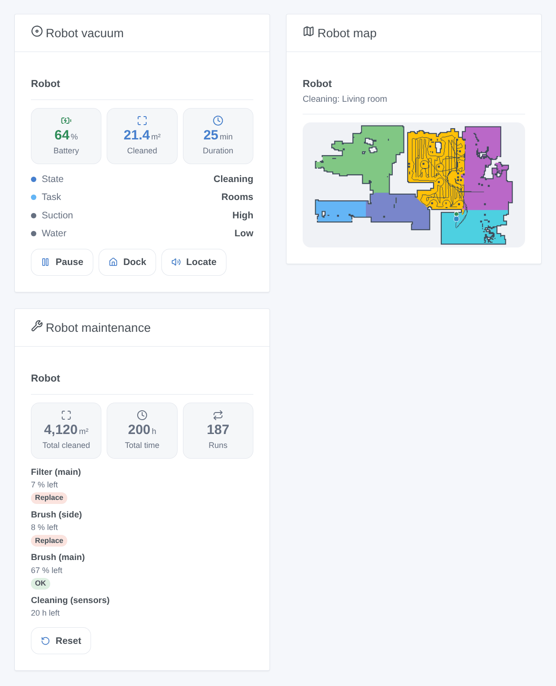

# Valetudo

## Overview

This integration drives robot vacuums running **Valetudo** (valetudo.cloud), the open firmware that replaces the manufacturer cloud, through its official local REST API: no account, nothing leaves your network. Each robot becomes a Gladys device with the native robot vacuum features (state, cleaning, dock, battery), its suction and water presets and the remaining life of its consumables. Scene actions clean rooms by name and control the robot; scene triggers tell when a cleaning starts or ends, when the robot is in error or needs you. Three dashboard widgets show the robot, its live map and its maintenance.

Not affiliated with the Valetudo project. **Not tested on a real robot yet**: the requests follow the official API of Valetudo 2026.10; feedback is welcome.

## Prerequisites

- Gladys Assistant 5.3.0 or later.
- A robot vacuum running Valetudo, on the same network as Gladys, whose Valetudo page opens in a browser.
- Ideally, a fixed IP address for the robot in your router. Cleaning rooms needs a robot with room segmentation and a saved map.

## Configuration

1. Install the integration from the store, then open its configuration.
2. Leave **Find the robots automatically (mDNS)** on. For a robot on another network, type its address (IP or name, with `:port` if needed) in **Robot addresses**.
3. If HTTP authentication is on in Valetudo (Settings → Connectivity → Auth settings), type the same **user name** and **password**.
4. Choose the **language of the device texts** and click **Search and test the robots**: the message lists every robot found, with its address and battery.
5. Open the **Discover** tab and add your robots.

## Usage

Every robot gets these features, depending on what Valetudo offers for it:

| Feature    | Type                 | What it does                                                          |
| ---------- | -------------------- | --------------------------------------------------------------------- |
| State      | robot vacuum, sensor | Stopped, cleaning, paused, error, returning, charging, docked         |
| Cleaning   | robot vacuum, list   | Stop, Clean (starts or resumes), Map (a mapping pass, when supported) |
| Dock       | robot vacuum, button | Sends the robot back to its dock                                      |
| Battery    | battery, %           | Charge level                                                          |
| Suction    | list                 | The suction presets of the robot                                      |
| Water      | list                 | The water presets (mopping robots)                                    |
| Mode       | list                 | Vacuum, mop, vacuum and mop… (robots that offer it)                   |
| Consumable | maintenance, %       | Remaining life of each brush, filter, mop pad… that reports it        |

Changes are pushed by Valetudo as they happen; consumables and statistics are read every few minutes.

### Dashboard widgets

- **Robot vacuum**: state, battery, area and duration of the current run, suction and water, the error message; buttons **Start** / **Pause** / **Resume**, **Dock**, **Locate** and **Clean a room** (choose the room and the passes).
- **Robot map**: the live map drawn by the integration (rooms in colors, walls, path, robot in blue, dock in green, virtual walls and no-go areas in red), the room being cleaned in amber.
- **Robot maintenance**: lifetime area, time and runs, every consumable from the most worn (badge **Replace** under 10 %, **Soon** under 25 %), and **Reset** after you replaced one.

### Scenes

Actions: **Clean rooms with a robot vacuum** (room names as set in Valetudo, accents and case ignored, or room numbers, separated by commas; passes; optional suction and water set first; returns the rooms sent) and **Control a robot vacuum** (start or resume, pause, stop, back to the dock, locate, empty the bin at the dock, wash or dry the mop at the dock).

Triggers: **cleaning started**, **cleaning finished** (with the area in m² and the duration in minutes), **error** (with the message of the robot), **needs attention** (dust bin full, consumable worn out, mop pad reminder, something missing, map change to accept; filter by reason), **not answering** and **answering again**. The robot name is always a variable.

Examples:

- When everybody leaves home → clean "Kitchen, Living room" twice.
- When the cleaning is finished → send "{{triggerEvent.data.area_m2}} m² cleaned" to your phone.
- When the robot needs attention because the dust bin is full → flash the hall light.

## Troubleshooting

- **No robot found**: check that its Valetudo page opens at its address from another device, then type that address in the configuration and use **Search and test the robots**. mDNS does not cross VLANs or guest networks.
- **"refuses the user name or password"**: the credentials do not match the HTTP authentication of Valetudo.
- **"cannot do this"**: Valetudo has no such capability for this robot (a dock function, rooms, mapping); the message names it.
- **No map in the widget**: the robot has no saved map yet; let it finish a first full cleaning.
- For a bug report, give the versions of Gladys, of the integration and of Valetudo, the robot model, the message of the test button and the logs (add `DEBUG=gladys-integration-sdk` in developer mode): [open an issue](https://github.com/William-De71/gladys-valetudo/issues).
